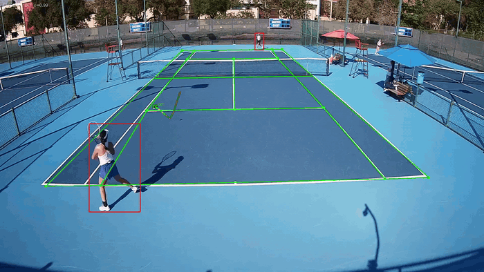

# Triton Ball Tennis

A GPU tennis-video tracker built around GridTrackNet temporal ball detection,
TensorRT player and court detection, and conservative motion/physics recovery.
It produces an annotated MP4 and per-frame tracking JSON.

## Demo

[](media/tracking_demo.mp4)

The overlay distinguishes where each selected point came from:

- **Green (`DET`):** a position supported by a GridTrackNet detection (may be smoothed)
- **Orange (`MOT`):** motion-supported recovery
- **Cyan (`PHY`):** short bounded interpolation or physics recovery

Raw detector coordinates are preserved in the JSON `measurement` field; `x/y`
are the selected, possibly smoothed position and `position_kind` distinguishes
measurement, filtered and recovered positions. Recovery is deliberately conservative: an
unresolved detector gap remains a gap instead of becoming a long predicted path.

## Pipeline

- GridTrackNet runs on raw RGB frames in five-frame temporal units at its native
  30 FPS cadence (30 or 60 FPS input is supported).
- Player and court models run through TensorRT.
- Motion masks support selection and short recovery but are not used to alter
  GridTrackNet's input.
- The ball-in-play selector rejects static objects and implausible track switches,
  closes safe one-frame holes, and exports the selected source for every frame.
- The renderer draws a short anti-aliased trail without inventing points across
  lost sections.

## Requirements

- Python 3.10 and an NVIDIA CUDA GPU
- CUDA-enabled PyTorch (install it from the PyTorch index for your CUDA version)
- NumPy, OpenCV (the GUI build, for the label tool)
- TensorRT 10 for the player and court engines
- BoxMOT for player tracking (without it players are not tracked)
- CatBoost, only for `--court`
- SciPy and psutil, optional (motion-debug trail smoothing; automatic frame-cache sizing)
- Ultralytics, only for exporting new engines with `build_trt_engines.py`
- pytest, for the tests and `clean_tracker.py --self-test`
- FFmpeg recommended for faster video encoding

`requirements.txt` lists these with the versions the last review ran with
(recorded in `audit/snapshot.json`); it is not a full lock file:

```powershell
pip install torch==2.10.0 --index-url https://download.pytorch.org/whl/cu128
pip install -r requirements.txt
```

The repository includes the GridTrackNet weight export, the CatBoost bounce
model and the TensorRT engines used by the default pipeline. TensorRT engines
are platform-specific and may need to be rebuilt for a different GPU or
TensorRT version.

## Usage

Run the bundled Pomona sample:

```powershell
python clean_tracker.py
```

Run another 30 or 60 FPS match:

```powershell
python clean_tracker.py --input path\to\match.mp4 --output output\tracking.mp4 --tracking-json output\tracking.json
```

Export JSON without rendering a video:

```powershell
python clean_tracker.py --input path\to\match.mp4 --tracking-json output\tracking.json --no-video
```

Use another CUDA device or detector threshold:

```powershell
python clean_tracker.py --device 1 --conf 0.55
```

## Fine-tuning GridTrackNet

The bundled GridTrackNet weights contain the latest fine-tuned checkpoint used
to produce the demo.

`finetune.bat` (or `.\finetune.ps1`) opens the fine-tuning workspace and runs
`finetune/ft.py`, which covers importing clips, labelling, checking labels,
scoring the detector, training and promoting the winner:

```powershell
.\finetune.ps1 status                       what is labelled and which model is current
.\finetune.ps1 add C:\clips\rally7.mp4      copy a video in and pre-label it
.\finetune.ps1 label rally7                 click-correct the labels
.\finetune.ps1 train --val-clips video10    fine-tune; keeps the better of new vs start
```

The videos and caches the workspace builds are regenerable and stay untracked;
`finetune/labels/` keeps the hand-corrected own-camera labels. See
`finetune/README.md` for the full loop and `finetune/DATASETS.md` for sources.

## Validation

Run the deterministic tracking checks and the synthetic regression tests:

```powershell
python clean_tracker.py --self-test
python -m pytest -q
```

Evaluate against annotations:

```powershell
python clean_tracker.py --no-video --annotations sample\pomona_annotations.json
```

Score the detector (or the full pipeline) on the hand-labelled clips with
`evaluate_archive.py`. `--archive` chooses the label set; pass it explicitly
so the result does not depend on `$TENNIS_ARCHIVE` or other machine state:

```powershell
python evaluate_archive.py --archive finetune --mode raw --clips video13
```

`check_parity.py` is a strict gate against the frozen Pomona benchmark, and
`validate_tracking.py` scores an exported tracking JSON against hand labels.

## Project structure

```text
clean_tracker.py                         Command-line entry point
evaluate_archive.py                      Detector/pipeline scoring on hand-labelled clips
validate_tracking.py                     Tracking JSON vs. hand labels
check_parity.py                          Frozen Pomona benchmark gate
build_trt_engines.py                     YOLO checkpoint -> ONNX -> TensorRT engine builder
requirements.txt                         Python packages (see Requirements)
tennis_tracker/pipeline.py               Run entry point: orders the stages, calls the selector
tennis_tracker/run_context.py            Data the stages pass each other
tennis_tracker/pass1.py                  Decode, motion evidence, ROIs and detections per frame
tennis_tracker/frame_window.py           Previous/current/next frames for pass 1's temporal gate
tennis_tracker/pass2.py                  Render the tracking and debug videos
tennis_tracker/export.py                 Tracking JSON export
tennis_tracker/motion.py                 CUDA background model and motion masks
tennis_tracker/motion_debug.py           Motion-debug video drawing
tennis_tracker/tracking.py               ROI tracking for motion search
tennis_tracker/detectors.py              GridTrackNet prepass, TensorRT ball/player/court backends
tennis_tracker/gridtracknet.py           GridTrackNet model and decoder
tennis_tracker/court_geometry.py         Court keypoints, side guides, polygon, homography
tennis_tracker/court_overlay.py          Bounces, player contacts, rally legs
tennis_tracker/court_minimap.py          Court minimap drawing
tennis_tracker/rendering.py              Frame drawing
tennis_tracker/summaries.py              Console summaries printed at the end of a run
tennis_tracker/video_io.py               Frame reader, video writer, CUDA uploads
tennis_tracker/                          Also config, frame-rate rules, host-side helpers
ball_in_play_selector/                   Track construction, scoring, and recovery
models/gridtracknet_weights_torch.npz    GridTrackNet inference weights
models/ctb_regr_bounce.cbm               CatBoost bounce model (--court)
models/                                  Player and court TensorRT engines
sample/                                  Sample video and validation annotations
finetune.bat / finetune.ps1              Front door for the fine-tuning workspace
finetune/                                Labelling, import, pre-labelling, and training tools
tests/                                   Synthetic regression tests (pytest)
audit/                                   Review reports, logs and verification scripts
output/                                  Generated videos, JSON, and reports (ignored)
```

## Current limitation

GridTrackNet can still miss a blurred ball or select a player/background feature.
The conservative selector prevents many false continuations, but correcting raw
green detector errors requires fine-tuning the model on additional labeled clips.
